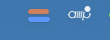

# usage-bar

A tiny macOS menu bar app that shows how much Claude and Codex usage you have left.



Two bars: Claude on top (orange), Codex below (blue). Each bar's fill is the share of the 5-hour window left. Click it for the 5-hour and weekly numbers with reset times. It refreshes every 5 minutes.

There's no separate login. It reuses the tokens the CLIs already store:

- **Claude:** Claude Code's `Claude Code-credentials` keychain entry. macOS asks once for keychain access; choose **Always Allow**.
- **Codex:** `~/.codex/auth.json`.

If a token has expired, run the matching CLI once to refresh it.

## Run

Needs macOS 14+ and Swift 6.

```sh
swift build -c release
.build/release/UsageBar
```

## Run in the background

Detached from the terminal:

```sh
nohup .build/release/UsageBar >/dev/null 2>&1 &
```

At login, with a LaunchAgent (replace the path with your checkout):

```sh
cat > ~/Library/LaunchAgents/com.github.usage-bar.plist <<EOF
<?xml version="1.0" encoding="UTF-8"?>
<!DOCTYPE plist PUBLIC "-//Apple//DTD PLIST 1.0//EN" "http://www.apple.com/DTDs/PropertyList-1.0.dtd">
<plist version="1.0">
<dict>
  <key>Label</key><string>com.github.usage-bar</string>
  <key>ProgramArguments</key><array><string>$PWD/.build/release/UsageBar</string></array>
  <key>RunAtLoad</key><true/>
</dict>
</plist>
EOF
launchctl load ~/Library/LaunchAgents/com.github.usage-bar.plist
```

Stop it with **Quit** in the menu, or `launchctl unload ~/Library/LaunchAgents/com.github.usage-bar.plist`.
